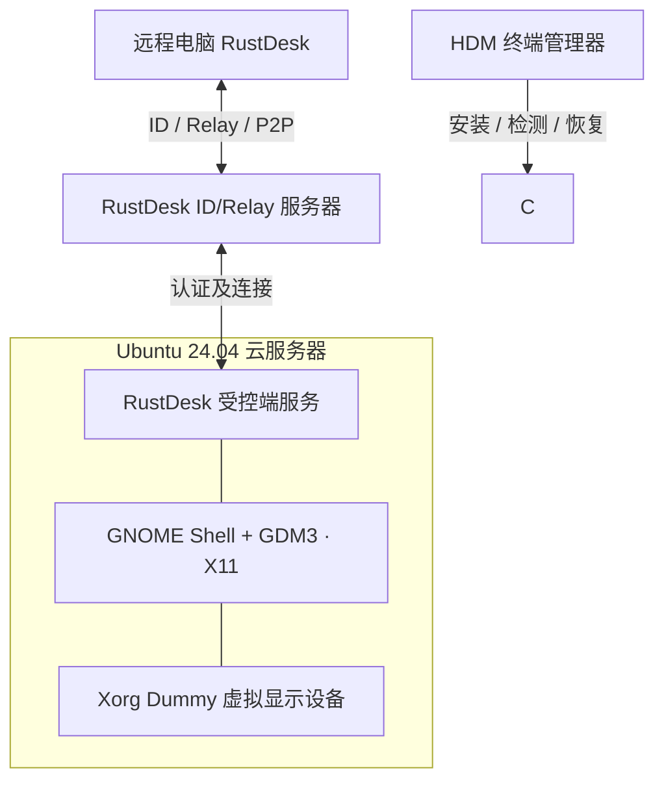

<div align="center">

# 🖥️ Headless Desktop Manager

### HDM · Linux 无显示器远程桌面一键部署与管理

**GNOME 优先 · 虚拟显示 · RustDesk · 安全恢复 · 终端菜单**

[](CHANGELOG.md)
[](https://github.com/nljie1103/headless-desktop-manager/actions/workflows/tests.yml)
[](docs/implementation-status.md)
[](docs/testing-and-limitations.md)

**🇨🇳 简体中文（当前页面）** · [🇬🇧 English](README.en.md) · [完整开发规格书](docs/AI_DEVELOPMENT_SPEC.md)

[快速安装](#-快速安装) · [功能导航](#-功能导航) · [部署架构](#-默认部署架构) · [安全须知](#-使用前请先阅读) · [开发进度](#-开发进度)

</div>

> [!WARNING]
> **当前为 v0.2.0 Preview，不是生产环境已验证版本。** 菜单与部分安装逻辑已实现，但 GNOME 登录界面是否被 RustDesk 正确捕获、无 GPU 软件渲染、重启后无人值守访问等，尚未在真实云服务器完成验收。强烈建议先建立云快照，保留 SSH 和云平台控制台。

## ✨ 项目可以做什么？

HDM 把无显示器 Linux 图形桌面所需的驱动、桌面环境、远控客户端、更新和恢复功能集中到一个终端菜单。不强制替换已有桌面，不会默默安装实验性组件。

| 功能 | 当前进度 | 说明 |
| :--- | :---: | :--- |
| **GNOME + GDM3/X11** | 🟡 代码可用，待实机 | 默认完整桌面；XFCE/MATE 可选 |
| **Xorg Dummy 虚拟显示** | 🟡 代码可用，待实机 | 分辨率预设、文件备份和回滚 |
| Xvfb / VKMS | 🧪 实验 | Xvfb 可配置编号、分辨率、色深；VKMS 检查内核 |
| RustDesk 客户端 | 🟡 代码可用，待实机 | 安装 / 版本选择 / 本地安装 / 自建服务器 |
| **菜单系统** | ✅ 本地验证 | 10 个主菜单、473 个条目，未实现项明确提示 |
| 下载源与校验 | 🟡 部分实现 | 系统 APT 优先，网络故障时使用官方备用源 |
| 配置备份与回滚 | 🟡 部分实现 | Xorg/GDM 变更采用配置快照及恢复计时器 |
| Windows 自动发布 | 🟡 待 Windows 验证 | 自动生成带版本号的提交并推送，不反复确认 |

状态说明：✅ 本地自动化检查通过；🟡 具备实现但未通过云服务器功能验收；🧪 仅供实验，不保证兼容。

## 🚀 快速安装

### 1. 准备服务器

首批写入操作仅支持 **Ubuntu 24.04 LTS x86_64**。建议准备云控制台、可用 SSH、系统快照、足够磁盘空间和内存（完整 GNOME 对资源要求较高）。

### 2. 下载安装器

```bash
curl -fsSLo hdm-install.sh https://raw.githubusercontent.com/nljie1103/headless-desktop-manager/main/install.sh && sudo bash hdm-install.sh
```

> 该命令使用可变的 `main` 开发分支。建议阅读下载的 `install.sh`；正式稳定版本应使用固定 Release 和经过独立核验的 SHA-256/签名。首次安装 HDM **不会直接安装 GNOME 或 RustDesk**。

### 3. 打开 HDM

```bash
sudo hdm
```

推荐第一次进入 **`9 → 9.1 → 9.1.6`**，预览并执行 GNOME + Xorg Dummy + RustDesk 安装流程。菜单仍会对危险的 Linux 系统更改单独确认，避免远程失联。

```text
╭──────────────────────────────────────────────────────────╮
│       Headless Desktop Manager (HDM) · v0.2.0           │
│  虚拟显示器  /  GNOME 桌面  /  RustDesk 远程管理         │
├──────────────────────────────────────────────────────────┤
│  1  安装虚拟显示器         6  更新 RustDesk             │
│  2  管理虚拟显示器         7  配置 ID / 中继服务器       │
│  3  安装桌面环境           8  更新 HDM 管理器           │
│  4  管理桌面环境           9  ⭐ 一键安装推荐组合       │
│  5  安装 RustDesk         10  系统检测 / 故障修复       │
│                                                          │
│  0  返回/退出              q  退出程序                   │
╰──────────────────────────────────────────────────────────╯
```

*上图为 README 的排版示意，终端实际界面由 `ui/menu.sh` 生成。*

## 🧭 功能导航

| 模块 | 安装 | 更新 / 管理 | 关键子功能 |
| --- | --- | --- | --- |
| 显示器 | `1` | `2` | Xorg Dummy / Xvfb / VKMS、分辨率、配置恢复 |
| 桌面 | `3` | `4` | GNOME（默认）、XFCE、MATE、GDM3、X11 |
| RustDesk | `5` | `6` | 官方版本、本地安装包、检查更新、卸载 |
| 服务器 | `7` | — | ID、Relay、公钥、设备 ID、无人值守密码 |
| 管理器 | — | `8` | Release 检查、下载验证、回滚 |
| 一键向导 | `9` | — | GNOME + Dummy + RustDesk 推荐组合 |
| 故障恢复 | — | `10` | 诊断、日志、系统服务、软件源、配置快照 |

所有二三级菜单保留于 [`docs/menu-guide.md`](docs/menu-guide.md)；开发者必须以 [`docs/AI_DEVELOPMENT_SPEC.md`](docs/AI_DEVELOPMENT_SPEC.md) 为完整菜单依据。**菜单存在不等于功能已通过实机测试**。

## 🧩 默认部署架构



> 实际连接可能使用 P2P 或中继；HDM 不保证所有云服务器上的图形捕获成功。Xvfb/VKMS 不会自动代替上述默认组合。

## 📦 软件获取原则

```text
发行版自带 APT / DNF / YUM（首选，当前写入仅实现 Ubuntu APT）
    └── 下载源网络故障 → 可信发行版镜像（不绕过签名）
          └── 适用时 → RustDesk 官方 Releases
                └── 适用且已有实际文件时 → HDM GitHub Releases 备用包
```

- **GNOME** 有大量系统依赖，不适合靠 GitHub 散装 `.deb` 来代替完整 APT 仓库。
- RustDesk 备用包必须真实上传，并有可信 SHA-256/许可证信息；项目当前**未提供**可用的 GitHub `.deb` 镜像。
- GPG 签名错误、架构不匹配、依赖冲突等必须停止，不能通过“更换下载源”绕过。

## 🛡️ 使用前请先阅读

1. **保留 SSH 和云服务器救援控制台**；在修改 Xorg/GDM3 前创建云端系统快照。
2. HDM 不自动关闭防火墙、不允许无提示自动登录、不关闭默认屏幕锁定，也不会在安装结束时强制重启。
3. 显示相关高风险变更会备份配置并启动自动恢复计时器。远端图形确认无误后，执行 `sudo hdm --confirm-display`，否则约 7 分钟后可能恢复旧配置。
4. RustDesk `--password` 命令行传参可能短暂暴露在同机进程列表中；菜单会明示风险。HDM 不保存明文访问密码。
5. **真正安装成功**必须经过从另一台设备的图形连接、鼠标键盘、重启后的无人值守回归测试；本地静态测试不代表通过这些验收。

## 🛠️ 常用命令

```bash
sudo hdm                   # 打开终端菜单
hdm --version              # 查看版本
hdm --menu-tree            # 查看全部子菜单
sudo hdm --diagnose        # 只读诊断
hdm --status-json          # 机器可读 JSON 诊断
sudo hdm --confirm-display # 确认显示配置生效，取消回滚
sudo hdm --rollback-pending # 手动恢复待回滚配置
```

## 🧑‍💻 开发与贡献

- **源码规范与 AI 交接**：[`docs/AI_DEVELOPMENT_SPEC.md`](docs/AI_DEVELOPMENT_SPEC.md)
- **当前实现与限制**：[`docs/implementation-status.md`](docs/implementation-status.md)
- **开发手册**：[`docs/development.md`](docs/development.md)
- **安装和故障排查**：[`docs/installation.md`](docs/installation.md) · [`docs/troubleshooting.md`](docs/troubleshooting.md)
- **GitHub 地址与更新策略**：[`docs/repository-endpoints.md`](docs/repository-endpoints.md)
- **提交规范**：[`docs/COMMIT_POLICY.md`](docs/COMMIT_POLICY.md) — `v版本号 + 真实变更描述`

本地测试（不会改动运行机的显示器或桌面配置）：

```bash
bash tests/run.sh
```

## 🗺️ 开发进度

- [x] v0.1.x — 模块化工程、完整菜单树、基础安装与诊断、初版发布脚本
- [x] v0.2.0 — 中文首页、英文次级文档、Windows 无重复确认的自动推送、Xvfb 配置完善及增强测试
- [ ] 云服务器实机：GNOME/GDM3/Xorg Dummy/RustDesk 画面捕获和无人值守验证
- [ ] 完整官方/自建 ID/Relay 服务器端到端测试与版本兼容性矩阵
- [ ] 更多发行版、CPU 架构、备用安装包的可重复签名构建

---

<div align="center">

由社区维护的开放项目 · [Issues](https://github.com/nljie1103/headless-desktop-manager/issues) · [Releases](https://github.com/nljie1103/headless-desktop-manager/releases) · [LICENSE](LICENSE)

*RustDesk 属于其上游独立项目，HDM 与 RustDesk 官方无隶属关系。*

</div>
